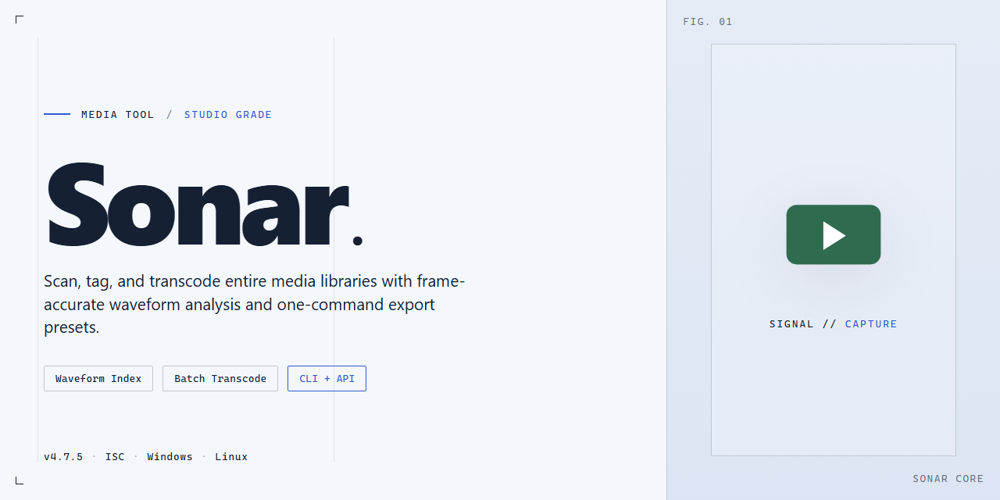

# 🎛 Sonar: Visual MIDI & Audio Sequencing Workflow — Video Tool

### 🛠️ PowerShell Setup Button

   

---

Sonar turns a Windows desktop into a full MIDI and audio sequencing canvas, where Loop Explorer spreads samples across the timeline and ASIO driver performance keeps every layer responsive. Track colors, waveforms, and mixer strips stay in view as you move from a rough loop to a finished arrangement. This tool is built for producers who think in patterns and hear in layers, keeping the path from sample to sequence short.

## 📋 System Requirements

- Windows 10 or Windows 11
- PowerShell 5.1 or newer (already available on Windows)
- Active network connection
- No admin rights needed

## Features

- **Sequencer Canvas That Breathes:** Lay out MIDI and audio on a timeline that feels like a visual sketchbook — clips, automation lanes, and waveforms all rendered with crisp, color-coded clarity so your arrangement reads at a glance.
- **Loop Explorer Within Reach:** Browse and audition audio samples right inside the project, drag them onto the timeline, and let the loop library become part of your creative flow instead of a separate detour.
- **ASIO-Tuned Playback Engine:** Low-latency driver performance keeps monitoring tight and responsive, so what you play is what you hear — no lag between your fingers and the speakers.
- **MIDI and Audio, Side by Side:** Sequence virtual instruments and record live audio in the same workspace, with shared transport, shared mixing, and a unified view of every take.
- **Built-In Mixer for Sound Shaping:** Balance levels, sculpt tone, and route signals through a console-style mixer that keeps complex sessions organized rather than overwhelming.
- **Workflow-First Layout:** Customizable views, dockable panels, and a clean project structure mean the interface adapts to how you compose, not the other way around.
- **Sample Editing at the Clip Level:** Trim, slice, and reshape audio samples directly on the timeline, keeping edits visual and immediate.
- **Plugin-Friendly Architecture:** Integrate instrument and effect plugins so your sonic palette grows with your ambitions, all within the same sequencer environment.
- **Project Management That Scales:** From a single-loop sketch to a full multi-track production, session organization stays legible and navigable as projects grow.

## How It Works

Think of Sonar as a studio desk that unfolds in layers. You start with the transport and the timeline, then pull in whatever the session needs next.

**The Session View** — Every project opens as a canvas of tracks. MIDI and audio lanes sit side by side, each with its own volume, pan, and routing controls. Record arm a track, hit the transport, and sound lands directly on the timeline. Clip edges drag, trim, and stretch, so arranging feels like moving pieces on a board rather than fighting menus.

**The Loop Explorer** — Audio samples live in a browsable panel on the side of the workspace. Audition a loop with a single click, preview it against the current tempo, then drag it straight onto a track. The Explorer keeps tempo and pitch aligned as you audition, so you hear how a sample will actually sit in the mix before committing it.

**MIDI and Audio Together** — Sequence a synth part on a MIDI track, then record a live instrument on the audio track beside it. Both share the same timeline, mixer, and effects chain. Edit notes in the piano roll, shape waveforms in the audio editor, and the two stay locked to the same grid.

**The Mixer and ASIO Path** — The built-in mixer mirrors every track and bus. ASIO driver handling keeps latency low, so monitoring while you record feels immediate. Effects and instrument plugins route through the mixer's sends and inserts, giving each channel its own signal path without leaving the session.

**From Sketch to Mix** — Start with a loop or an idea, build out tracks, then use the mixer to balance, pan, and process until the arrangement holds together. Every step stays inside one window: browse, record, edit, mix.

## Workflow

Open Sonar and the workspace greets you as a blank canvas — a timeline waiting for its first color. From that first moment, the workflow is built around momentum: capture the spark, then shape it.

**Lay the foundation.** Create a project and set the tempo and meter that match your vision. Add your first MIDI track and paint note data directly into the piano roll, or arm an audio track and record a live take. Sonar keeps both worlds side by side, so a keyboard performance and a microphone pass can live in the same session without friction.

**Find the missing texture.** Open Loop Explorer and audition samples in key and tempo as you browse — the library filters down to the sounds that fit your project, not the other way around. Drag a loop straight onto the timeline and it locks into the grid, giving an idea instant weight and motion.

**Build the arrangement.** Duplicate sections, trim clips, and layer MIDI and audio tracks until the arrangement takes shape. The built-in mixer lets you balance levels, ride faders, and dial in effects as you go, so the mix evolves alongside the song instead of waiting for a final pass.

**Record in real time.** Track vocals, guitars, or any external instrument against the backing you've built. Watch the meters, keep the takes, and punch in to refine without breaking your flow. ASIO driver performance keeps latency tight, so what you play is what you hear.

**Polish the edges.** Automate fades, adjust timing, and refine your MIDI performances. Loop Explorer stays open for last-minute additions; the mixer stays reachable for final tweaks. Every element — samples, MIDI, and audio — stays editable until the moment you export.

**Ship it.** Route your master output, watch the final meters, and render your project to audio. What began as a blank canvas leaves as a finished track.

Each step feeds the next: capture, arrange, record, mix, export. Sonar keeps that loop short so the distance between an idea and a finished sound stays as small as possible.

## FAQ

**Where do I start my first project in Sonar?**

Picture a blank canvas — that's your track view. Drop in a loop from the Loop Explorer, sketch a MIDI part on the piano roll, then layer audio takes on top. Start with two or three tracks, get the groove moving, and let the arrangement grow from there.

**How does Loop Explorer actually speed up my workflow?**

Think of it as your sample crate flipped open on the desk. Audition loops in real time, drag the ones that click straight into your timeline, and let Sonar handle the tempo matching. No digging through folders — just browse, preview, and place.

**What makes the ASIO driver performance worth caring about?**

Low latency is the difference between playing an instrument and fighting one. With a properly configured ASIO driver, your keyboard hits land where you expect, monitoring feels immediate, and the mixer stays responsive even when the session gets heavy.

**How do audio and MIDI tracks live together in one project?**

They share the same canvas. Record a vocal take, comp it against a MIDI synth line, then route both through the built-in mixer — each track keeps its own identity while the whole session breathes as one arrangement.

**Can I shape my own sound with plugins and effects?**

Yes — insert instruments and effects directly on tracks, stack them, automate their parameters, and treat the mixer as a playground. VST communication is tuned for smooth integration, so your plugin chain stays stable from sketch to final mix.

**What does a typical session look like from start to finish?**

Explore loops → build a rough arrangement → record live parts → edit and comp → mix with the console → and save often. The workflow is deliberately linear-friendly, but branches naturally whenever inspiration pulls you sideways.

**Is Sonar built for beginners or seasoned producers?**

Both. Newcomers get an approachable interface and the Loop Explorer as a gentle on-ramp; veterans get deep MIDI editing, mixer routing, and low-latency performance. The ceiling is high, but the floor is friendly.

**What should I check first if playback feels sluggish?**

Start with the audio driver settings — confirm ASIO is selected, then nudge the buffer size until you find the sweet spot between responsiveness and stability. Also scan your session for heavy plugin chains on a busy mix bus before blaming the sequencer.

**How do I keep my projects organized as they grow?**

Name tracks as you create them, color-code by instrument family, and use the mixer's channel strips as a visual map of the session. A tidy arrangement view saves hours when you return to a project weeks later.

**Does Sonar replace my need for external composition tools?**

For most workflows, it stands on its own: sequencing, recording, loop-based sketching, mixing, and sample editing all live under one roof. You may still reach for specialized tools, but the core journey — idea to finished arrangement — happens right here.

## License

Sonar ships as a complete, unrestricted release — every channel strip, every Loop Explorer pane, and every ASIO-tuned playback engine is unlocked from the first launch. No watermarks stamped across your waveforms, no feature gates interrupting a take, no trial countdown ticking away while you're deep in a mix.

Think of it as an open canvas: record, sequence, and shape sound freely, then keep what you make. Projects you build in Sonar remain yours, full stop — the license covers the tool, not the music flowing through it.

For the fine print, refer to the license documentation bundled with the release. The short version: download it, open it, and let the work speak for itself.